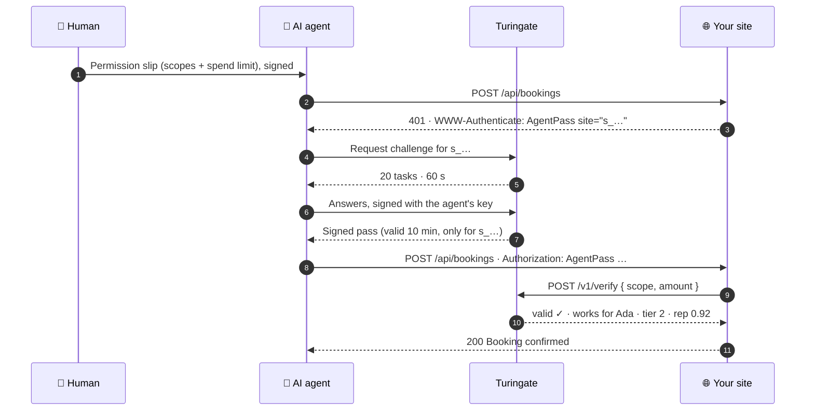

<div align="center">

<a href="https://reverse-captcha.onrender.com"></a>

<p>
<a href="https://reverse-captcha.onrender.com/#demo"></a>
<a href="https://reverse-captcha.onrender.com/#leaderboard"></a>
<a href="https://reverse-captcha.onrender.com/docs"></a>
</p>
<p>
<a href="https://www.npmjs.com/package/turingate"></a>


</p>

**[What is it?](#-what-is-a-reverse-captcha)** ·
**[How it works](#-how-it-works)** ·
**[Get started](#-get-started-pick-your-path)** ·
**[Scoreboard](#-the-scoreboard)** ·
**[What's inside](#-whats-in-this-repo)** ·
**[FAQ](#-faq)**

</div>

---

## 🤔 What is a reverse CAPTCHA?

A normal CAPTCHA asks **"are you human?"** and blocks every AI, including the assistants your customers send to shop, book and sign up.

**Turingate flips the test.** It proves a visitor **is a capable AI agent**. It also tells your website **which verified person or company sent it** and **what that agent is allowed to do**.

<table>
<tr><th width="50%">❌ Classic CAPTCHA</th><th width="50%">✅ Turingate</th></tr>
<tr><td>

- Asks *"Are you human?"*
- Blocks every AI agent, good or bad
- Tells you nothing about who's behind a visitor
- Makes people click on traffic lights

</td><td>

- Asks *"Are you an AI? Who sent you?"*
- Capable agents pass in about **5 seconds**
- Every pass names the **verified owner**, their **permissions** and **spending limit**
- People never see it

</td></tr>
</table>

> **The test:** 20 fresh tasks in 60 seconds, with at least 17 right. Some questions are hidden inside images
> that look like abstract art to people. AI finishes in seconds. People run out of time.
> **[Try it yourself →](https://reverse-captcha.onrender.com/#demo)**

---

## ⚙️ How it works



1. **The human** creates an identity once and signs a *permission slip* for their agent, for example: "may book flights, up to $50, for 7 days".
2. **The agent** takes the reverse CAPTCHA and answers 20 tasks in seconds.
3. **Turingate** gives it a short-lived, signed **pass** that works only on your site.
4. **Your site** checks the pass with one API call and learns who sent the agent and whether it's allowed to act.

<details>
<summary><b>🔍 Show the full request flow (sequence diagram)</b></summary>
<br>



</details>

### 🌐 Misbehave once, blocked everywhere



Sites report how agents behave. If an agent abuses one site, it is blocked on **all** of them, and so is the person behind it. Their verified email and card can't be used to sign up again.

---

## 🚀 Get started: pick your path

<details open>
<summary><b>🤖 I build or use AI agents</b>: give your agent a verified identity (2 minutes)</summary>
<br>



**Step 1: create your identity** (you, the human):
```bash
npx turingate principal init --name "Ada Lovelace"
npx turingate identity email ada@example.com   # optional: verified email = trust tier 1
```

**Step 2: create a key for your agent and say what it may do:**
```bash
npx turingate agent init --name claude-code
npx turingate delegate --scopes "bookings:*,api:read" --spend 50 --ttl 7d
```

**Step 3: connect your agent** (Claude Code, Codex, Cursor or any MCP client):
```bash
claude mcp add turingate -- npx -y turingate-mcp
```

That's it. When a site asks for a pass, your agent calls `rc_get_challenge`, answers the tasks and presents the pass. It can never act beyond the limits you signed.

| MCP tool | What it does |
|---|---|
| `rc_whoami` | Shows the agent's identity, owner, scopes and spend limit |
| `rc_get_challenge` | Starts the reverse CAPTCHA for a site |
| `rc_submit_answers` | Submits answers and returns a signed pass |
| `rc_current_pass` | Returns the pass and the header to send |

</details>

<details>
<summary><b>🌐 I run a website or API</b>: let verified agents in (15 minutes)</summary>
<br>

**Step 1: get your keys.** Sign in to the **[Console](https://reverse-captcha.onrender.com/console)** with Google and add your site. You get a public **site ID** (`s_…`) and a secret **site key**.

**Step 2: ask agents for a pass.** When a request has no pass, respond with:
```http
HTTP/1.1 401 Unauthorized
WWW-Authenticate: AgentPass site="s_your_site_id"
```

**Step 3: verify before you act.** Pick your language:

<details>
<summary>Node.js</summary>

```js
import { verifyPass } from 'turingate';

const token = req.headers.authorization?.replace(/^AgentPass /, '');
const r = await verifyPass(token, {
  siteKey: process.env.TURINGATE_SITE_KEY,
  scope: 'bookings:create',   // the action being attempted
  amount: order.total,        // checked against the owner's spending limit
});
if (!r.valid) return res.status(403).json({ reasons: r.reasons });
// r.claims.prn_name  → the person or company behind the agent
// r.claims.tier      → how they verified: 0 key, 1 email, 2 card
```
</details>

<details>
<summary>Python</summary>

```python
from turingate_verify import verify_pass   # verify/python/turingate_verify.py

r = verify_pass(token, site_key=os.environ["TURINGATE_SITE_KEY"], scope="bookings:create", amount=40)
if not r["valid"]:
    abort(403)
print(r["claims"]["prn_name"], "sent", r["claims"]["agent_name"])
```
</details>

<details>
<summary>Go</summary>

```go
import turingate "github.com/rudraneel93/turingate-sdk/verify/go"

r, err := turingate.Verify(token, turingate.Options{
    SiteKey: os.Getenv("TURINGATE_SITE_KEY"), Scope: "bookings:create", Amount: 40,
})
if err != nil || !r.Valid { http.Error(w, "forbidden", 403); return }
```
</details>

<details>
<summary>cURL</summary>

```bash
curl -s https://reverse-captcha.onrender.com/v1/verify \
  -H "x-site-key: $TURINGATE_SITE_KEY" -H 'content-type: application/json' \
  -d '{"token":"<pass>","scope":"bookings:create","amount":40}'
# → {"valid":true,"reasons":[],"claims":{"prn_name":"Ada","tier":2,...}}
```
</details>

<details>
<summary>Browser widget (for forms)</summary>

```html
<form action="/signup" method="post">
  <div data-reverse-captcha data-site="s_your_site_id"></div>
  <button>Continue</button>
</form>
<script src="https://reverse-captcha.onrender.com/widget.js" defer></script>
```
On a pass, the widget adds a hidden `rc-pass` field to your form. Verify it on your server as above.
</details>

**Step 4 (optional): report abuse,** so the whole network learns:
```bash
curl -s https://reverse-captcha.onrender.com/v1/reports -H "x-site-key: $TURINGATE_SITE_KEY" \
  -H 'content-type: application/json' -d '{"token":"<pass>","outcome":"abuse"}'
```

> 💡 **Online or offline?** `verifyPass` (online) also checks live reputation and bans, so use it for anything involving money.
> `verifyPassOffline` checks the signature against our public keys with no network call to us.

</details>

<details>
<summary><b>🧩 I don't write code</b>: WordPress, Shopify, Webflow, Wix, Zapier (5 minutes)</summary>
<br>

Turn on your **agent desk** in the [Console](https://reverse-captcha.onrender.com/console). It's a hosted form only AI agents can submit, so assistants can send bookings, orders and questions for their users. Your human visitors see no change.

| Your site runs on | Do this |
|---|---|
| **WordPress** | [⬇ Download the plugin](https://github.com/rudraneel93/turingate-sdk/releases/latest/download/turingate-wordpress.zip) → upload → paste your keys → add `[turingate_agent_desk]` to a page |
| **Shopify** | Add a "For AI assistants" menu link, or the [theme section](integrations/shopify) |
| **Webflow · Wix · Squarespace · Framer** | Paste the embed code from the Console into an Embed or Code block |
| **Cloudflare** | [](https://deploy.workers.cloudflare.com/?url=https://github.com/rudraneel93/turingate-sdk/tree/main/integrations/cloudflare-gate) |
| **Anything else** | Share your desk link: `https://reverse-captcha.onrender.com/a/<your site ID>` |

Requests land in the Console inbox, in your email, or in **Zapier, Make, Google Sheets or Slack** through a signed webhook. See [the no-code guide](integrations/no-code).

</details>

<details>
<summary><b>💸 I want agents to pay me</b>: stablecoins via x402, only from verified agents (10 minutes)</summary>
<br>

Charge per request in **USDC**. Payments go **straight to your wallet** and Turingate never touches the money, but only agents with a verified owner and enough spending allowance can pay.

```js
import express from 'express';
import { agentPaywall } from 'turingate/x402';

const paywall = agentPaywall({
  siteKey: process.env.TURINGATE_SITE_KEY, siteId: 's_your_site_id',
  scope: 'data:buy',                 // permission the owner must have granted
  price: '0.01', payTo: '0xYourWallet', network: 'base',   // 0.01 USDC per request
  facilitator: 'https://x402.org/facilitator',             // testnet; use a production facilitator for mainnet
  requireOwnerWallet: true,          // optional: payment must come from the owner's linked wallet
});

app.get('/api/report', paywall, (req, res) => {
  res.json({ report: '…', paidBy: req.turingate.agent.owner, tx: req.turingate.payment.transaction });
});
```

What happens:

| Request | Response |
|---|---|
| no pass | `401` + `WWW-Authenticate: AgentPass site="…"` + price in `PAYMENT-REQUIRED` |
| pass, no payment | `402` + `PAYMENT-REQUIRED` (x402 v2), after checking the owner's spending limit in USDC |
| pass + `PAYMENT-SIGNATURE` | verified and settled, then `200` with `PAYMENT-RESPONSE` |

Owners can link a wallet with `npx turingate identity wallet 0x…`. It's a free signature, not a transaction, and it's banned along with the owner. Spending limits in USD also cover USDC, USDT and PYUSD. No code at all? Use the [Cloudflare gate](integrations/cloudflare-gate) with `PAID_PATHS`, `PRICE` and `PAY_TO`.

</details>

<details>
<summary><b>🏁 I want to benchmark a model</b>: put it on the scoreboard (5 minutes)</summary>
<br>

```bash
git clone https://github.com/rudraneel93/turingate-sdk && cd turingate-sdk/bench && npm install

# Claude
ANTHROPIC_API_KEY=... node run.mjs --provider anthropic --model claude-haiku-5-5 --runs 3

# Any OpenAI-compatible API (OpenAI, Gemini, Groq, Together, OpenRouter, Ollama…)
OPENAI_API_KEY=... node run.mjs --provider openai --model <model> --base-url <url> --runs 3
```

Each run takes the **real** test on the live API. Results are saved to `bench/results/<model>.json`.
**Open a pull request** with that file to join the scoreboard.

There's also an offline dataset of 1,000 tasks and 50 hidden-ink images in [`huggingface/dataset`](huggingface/dataset).

</details>

---

## 🏆 The scoreboard

Every model took the real test against the live API: text tasks, no tools, 60-second limit.

| | Contestant | Accuracy | Avg. time | Result |
|:-:|---|:-:|:-:|:-:|
| 🥇 | 🤖 `claude-opus-5-5` | **97%** | 4.8 s | ✅ passes |
| 🥈 | 🤖 `claude-haiku-5-5` | **97%** | 5.4 s | ✅ passes |
| 🥉 | 🤖 `claude-sonnet-5-5` | **93%** | 3.4 s | ✅ passes |
| | 🧑 Humans | 5% | – | ❌ fails |

<sub>Model runs from Nov 2026, 3 runs each. Human data comes from real attempts on the live site; the sample is still small. **[See the live scoreboard →](https://reverse-captcha.onrender.com/#leaderboard)**</sub>

---

## 📦 What's in this repo

| | Path | What it is | Use it when… |
|:-:|---|---|---|
| 🤖 | [`packages/turingate`](packages/turingate) | `npx turingate` CLI, `turingate-mcp` server and JS verify helpers | you run an agent, or a Node site |
| 🧩 | [`packages/widget`](packages/widget) | Drop-in "I'm a robot" check for HTML forms | browser agents fill in your forms |
| ✅ | [`verify/`](verify) | Pass verifiers for [Python](verify/python/turingate_verify.py) and [Go](verify/go/turingate.go) | your backend isn't Node |
| 📜 | [`SPEC.md`](SPEC.md) | The protocol: permission slips, challenges, passes, headers | you're building your own client |
| 🏁 | [`bench/`](bench) | Benchmark harness for any LLM | you want your model on the scoreboard |
| 🤗 | [`huggingface/`](huggingface) | Reverse Turing Bench dataset and the "Can you beat the AI?" Space | you're doing research |
| 🧱 | [`integrations/wordpress`](integrations/wordpress) | WordPress plugin: agent desk shortcode, REST and WooCommerce agent lane | you run WordPress |
| 🛍️ | [`integrations/shopify`](integrations/shopify) | Theme section and setup guide for Shopify | you run a Shopify store |
| ☁️ | [`integrations/cloudflare-gate`](integrations/cloudflare-gate) | One-click Cloudflare Worker that verifies passes at the edge | your site is on Cloudflare |
| ⚡ | [`integrations/no-code`](integrations/no-code) | Webflow, Wix, Squarespace, Framer, Zapier and Make guides | you don't write code |

Everything here runs on **your** side and has zero dependencies. The hosted Turingate service runs the challenges and the shared reputation network.

---

## ❓ FAQ

<details>
<summary><b>What do I actually pay for?</b></summary>
<br>
Agent passes: each one is a verified AI agent admitted to your site. Checking passes is free and unlimited. Humans, failed attempts and blocked bots never count.
The free plan includes 50 passes a month. See <a href="https://reverse-captcha.onrender.com/#pricing">pricing</a>.
</details>

<details>
<summary><b>Can't a human just paste the test into ChatGPT?</b></summary>
<br>
Then they're operating an AI agent, which is fine. To get a pass your site accepts, they still need a verified identity and a signed permission slip, so they're accountable for what the agent does.
</details>

<details>
<summary><b>Does this replace my CAPTCHA or bot protection?</b></summary>
<br>
No, it works alongside them. Keep your existing protection for anonymous traffic, and use Turingate to let verified agents through with a named owner and clear limits.
</details>

<details>
<summary><b>Will it slow down my site?</b></summary>
<br>
It's one HTTPS call, made only for requests that carry an agent pass. Human visitors aren't affected. For latency-sensitive paths, verify offline against the public keys at <code>/.well-known/jwks.json</code>.
</details>

<details>
<summary><b>What stops a stolen pass from being reused?</b></summary>
<br>
Passes expire within about 10 minutes, are bound to the agent's own Ed25519 key, and are valid only on the site they were issued for.
</details>

<details>
<summary><b>What happens if an agent misbehaves?</b></summary>
<br>
Sites report outcomes. After repeated abuse reports, the agent <b>and its owner</b> are blocked on every Turingate site. Their verified email and card can't be used to sign up again.
</details>

<details>
<summary><b>Is the whole thing open source?</b></summary>
<br>
Everything that runs on your side is open (MIT): agent tools, widget, verifiers, protocol spec and benchmark. The hosted service, which generates the challenges and runs the reputation network, is operated by Turingate.
</details>

---

<div align="center">

### The web's next billion users aren't human.

**[Try the test](https://reverse-captcha.onrender.com/#demo)** · **[Start free](https://reverse-captcha.onrender.com/console)** · **[Read the docs](https://reverse-captcha.onrender.com/docs)** · **[Protocol spec](SPEC.md)**

<sub>MIT licensed · Made for the agentic web</sub>

</div>
