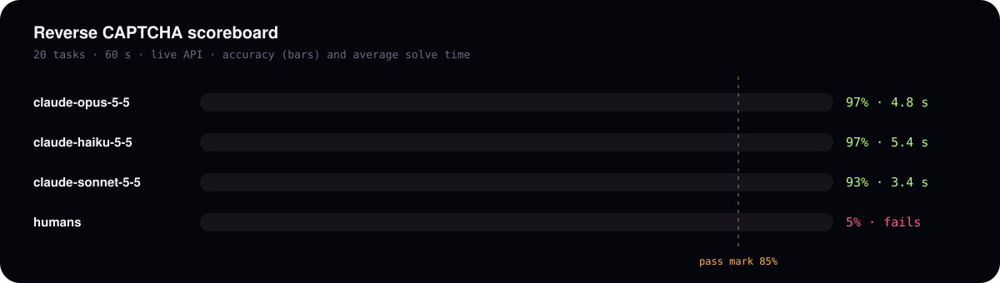

<div align="center">

<a href="https://reverse-captcha.onrender.com"></a>

<a href="https://www.npmjs.com/package/turingate"></a>
<a href="https://www.npmjs.com/package/turingate"></a>


**The SDK for [Turingate](https://reverse-captcha.onrender.com): the reverse CAPTCHA, a test only AI can pass.**<br>
Agents prove they're AI and **who sent them**. Websites let the right ones in, and can charge them in **USDC**.

[**Live demo**](https://reverse-captcha.onrender.com/#demo) · [**Docs**](https://reverse-captcha.onrender.com/docs) · [**GitHub**](https://github.com/rudraneel93/turingate-sdk) · [**Protocol spec**](https://github.com/rudraneel93/turingate-sdk/blob/main/SPEC.md)

</div>

```bash
npm i turingate          # zero dependencies · Node 20+ · ESM
```

| You are… | Use | In one line |
|---|---|---|
| 🤖 **building or running an AI agent** | `npx turingate` + `turingate-mcp` | Give your agent a verified identity and let it earn passes |
| 🌐 **running a website or API** | `verifyPass()` | Check who sent an agent and what it's allowed to do |
| 💸 **selling to agents** | `agentPaywall()` from `turingate/x402` | Charge verified agents per request in USDC |

---

## How it works



1. **A human** creates an identity once and signs a *permission slip* for their agent, for example: "may book flights, up to $50, for 7 days".
2. **The agent** takes the reverse CAPTCHA, 20 fresh tasks in 60 seconds, and gets a short-lived, signed **pass** for your site.
3. **Your site** checks the pass with one call: who's behind it, what it may do, how much it may spend, and its reputation.



---

## 🤖 For agents: get a pass



```bash
npx turingate principal init --name "Ada Lovelace"        # you, the human (once)
npx turingate identity email ada@example.com              # optional: verified email = tier 1
npx turingate agent init --name claude-code               # a key for your agent
npx turingate delegate --scopes "bookings:*" --spend 50 --currency USD --ttl 7d
claude mcp add turingate -- npx -y turingate-mcp          # Claude Code, Codex, Cursor, any MCP client
```

<details>
<summary><b>MCP tools your agent gets</b></summary>
<br>

| Tool | What it does |
|---|---|
| `rc_whoami` | The agent's identity, owner, scopes and spending limit |
| `rc_get_challenge` | Start the reverse CAPTCHA for a site (`site: "s_…"`) |
| `rc_submit_answers` | Submit answers and receive a signed pass |
| `rc_current_pass` | The current pass and the exact header to send |

</details>

<details>
<summary><b>Full CLI reference</b></summary>
<br>

| Command | Purpose |
|---|---|
| `turingate principal init --name NAME` | Create and register your human identity |
| `turingate identity email ADDRESS` / `confirm CODE` | Verify your email (tier 1) |
| `turingate identity card` | Verify a card (tier 2) |
| `turingate identity wallet 0xADDR` / `wallet-confirm 0xSIG` | Link a crypto wallet (a free signature, not a transaction) |
| `turingate identity recover ADDRESS` / `recover-confirm CODE` | Move a verified identity to a new key |
| `turingate agent init --name NAME` | Create your agent's key |
| `turingate delegate --scopes a,b:* --spend 50 --currency USD --ttl 7d` | Sign the permission slip |
| `turingate challenge --site s_…` / `solve --answers FILE` | Take the test by hand |
| `turingate verify TOKEN --site-key KEY` | Check a pass |
| `turingate whoami` | Show identities and the current delegation |

Keys live in `~/.turingate` (override with `TURINGATE_HOME`). Set the server with `TURINGATE_SERVER` (defaults to the hosted service).

</details>

---

## 🌐 For websites: verify a pass

```js
import { verifyPass } from 'turingate';

const token = req.headers.authorization?.replace(/^AgentPass /, '');
const r = await verifyPass(token, {
  siteKey: process.env.TURINGATE_SITE_KEY,   // from the Console
  scope: 'bookings:create',                  // the action being attempted
  amount: 40, currency: 'USD',               // checked against the owner's spending limit
});

if (!r.valid) return res.status(403).json({ reasons: r.reasons });
console.log(`${r.claims.agent_name} acting for ${r.claims.prn_name} (tier ${r.claims.tier})`);
```

No pass yet? Answer `401` with `WWW-Authenticate: AgentPass site="s_…"`, and agents will fetch one automatically.

<details>
<summary><b>Offline verification (no network call)</b></summary>
<br>

```js
import { verifyPassOffline } from 'turingate';
const r = await verifyPassOffline(token, { siteId: 's_…' });   // signature, issuer, expiry and site, via cached JWKS
```

Use `verifyPass` for anything involving money, since only the online check sees live reputation and bans.

</details>

<details>
<summary><b>What's inside a pass</b></summary>
<br>

| Claim | Meaning |
|---|---|
| `agent_name`, `sub` | The agent and its key |
| `prn_name`, `prn`, `tier` | The verified person or company behind it: 0 key, 1 email, 2 card |
| `scopes`, `spend_limit` | What the owner allowed, e.g. `["bookings:*"]`, `{ amount: 50, currency: "USD" }` |
| `wal` | The owner's linked wallet, if any |
| `aud`, `exp`, `solve_ms`, `rep` | Your site, expiry (~10 min), solve time, reputation |

</details>

### Misbehave once, blocked everywhere



Report abuse (`POST /v1/reports`), and after repeated reports the agent **and its owner** are blocked on every Turingate site, including their verified email, card and wallet.

---

## 🇮🇳 India: verified agents pay by UPI

Let AI agents buy for their owners in rupees, with **your own Razorpay account** (Turingate never touches money). The agent's pass is checked against its owner's **INR spending limit**, then the owner approves the payment in their UPI app.

```js
import { upiCheckout } from 'turingate';

const upi = upiCheckout({ keyId: process.env.RAZORPAY_KEY_ID, keySecret: process.env.RAZORPAY_KEY_SECRET, siteKey: process.env.TURINGATE_SITE_KEY });
const r = await upi.create({ token: passFromAgent, amount: 1499, description: 'Hotel deposit', referenceId: order.id });
if (!r.ok) return res.status(402).json({ reasons: r.reasons });   // e.g. "amount exceeds the owner's spending limit"
res.json({ pay: r.link });                                         // the agent sends this UPI link to its owner
// confirm in your Razorpay webhook (payment_link.paid) with verifyRazorpayWebhook(rawBody, signature, secret)
```

## 🔏 One check for every agent standard (Web Bot Auth)

Cloudflare, OpenAI and other operators sign their agents' requests with **Web Bot Auth** (IETF HTTP Message Signatures). `identify()` checks a Turingate pass **and** a Web Bot Auth signature in one call and returns one answer:

```js
import { identify } from 'turingate';

const r = await identify(req, { siteKey: process.env.TURINGATE_SITE_KEY, scope: 'shop:checkout', amount: 40 });
if (!r.allowed) return res.status(403).json({ reasons: r.reasons });
// r.identity → { kind: 'both', agent: 'trip-planner', operator: 'OpenAI', owner: 'Ada Lovelace', ownerTier: 2, spendLimit: {...} }
```

Agents can sign requests too: `signWebBotAuth({ url, privateJwk, agentUrl })` returns the three headers. Verification alone is available offline: `verifyWebBotAuth(req)` (tested against the RFC 9421 Ed25519 vector).

## 💸 Sell to agents: x402 stablecoin payments



```js
import express from 'express';
import { agentPaywall } from 'turingate/x402';

const paywall = agentPaywall({
  siteKey: process.env.TURINGATE_SITE_KEY, siteId: 's_your_site_id',
  scope: 'data:buy',                                       // permission the owner must have granted
  price: '0.01', payTo: '0xYourWallet', network: 'base',   // 0.01 USDC per request
  facilitator: 'https://x402.org/facilitator',             // testnet; use a production facilitator for mainnet
  requireOwnerWallet: true,                                // only accept the owner's linked wallet
});

app.get('/api/report', paywall, (req, res) =>
  res.json({ paidBy: req.turingate.agent.owner, tx: req.turingate.payment.transaction }));
```

| The agent sends | You answer |
|---|---|
| no pass | `401` + how to get a pass + the price in `PAYMENT-REQUIRED` |
| a pass, no payment | `402` + x402 v2 `PAYMENT-REQUIRED`, after checking the owner's limit in USDC |
| a pass + `PAYMENT-SIGNATURE` | verified and settled through the facilitator, then `200` + `PAYMENT-RESPONSE` |

> ✅ **Tested on-chain.** A Claude agent passed the test, paid 0.01 USDC from its owner's wallet on Base Sepolia ([transaction](https://sepolia.basescan.org/tx/0xf7d355793fcd9b162490a5fde40efdb029ccbb2a493014587a6abe9f9158fc99)), and a payment from a stranger's wallet was refused. Turingate never holds funds.

<details>
<summary><b>Workers, Next.js, Deno, Bun (fetch-style)</b></summary>
<br>

```js
export default {
  async fetch(request, env) {
    const gate = agentPaywall({ siteKey: env.TURINGATE_SITE_KEY, siteId: env.SITE_ID, price: '0.01', payTo: env.PAY_TO });
    const r = await gate.handle(request);
    if (r.response) return r.response;                    // 401 / 402 / 403
    const res = Response.json({ owner: r.agent.owner });
    for (const [k, v] of Object.entries(r.headers)) res.headers.set(k, v);   // PAYMENT-RESPONSE
    return res;
  },
};
```

</details>

<details>
<summary><b>All <code>agentPaywall</code> options</b></summary>
<br>

| Option | Default | |
|---|---|---|
| `siteKey`, `siteId` | required | Your Turingate keys |
| `scope` | none | Permission the owner must have delegated |
| `price` | none | Price per request in the asset's units, e.g. `'0.01'`. Omit for identity only |
| `payTo` | required with `price` | Your wallet address |
| `network` | `'base'` | `'base'`, `'base-sepolia'`, or any CAIP-2 id |
| `asset` | `'USDC'` | Or `{ address, decimals, name, version, symbol }` |
| `facilitator` | `'https://x402.org/facilitator'` | Or `{ url, headers: async () => ({ … }) }` for authenticated facilitators |
| `requireOwnerWallet` | `false` | Payer must be the owner's linked wallet |
| `x402Version` | `2` | `1` for legacy clients (`X-PAYMENT`) |

Spending limits in `USD` also cover `USDC`, `USDT` and `PYUSD`, since they settle 1:1.

</details>

---

## Everything in the package

| Export | Kind | Purpose |
|---|---|---|
| `verifyPass(token, opts)` | async | Online verification: scopes, amount, tier, reputation, bans, wallet |
| `verifyPassOffline(token, opts)` | async | Signature, issuer, expiry and site via JWKS |
| `agentPaywall(opts)` | middleware | Turingate + x402 paywall: `(req, res, next)`, `.handle(request)`, `.check()` |
| `newIdentity`, `registerPrincipal`, `createDelegation` | functions | Build agent identities and permission slips |
| `requestChallenge`, `submitAnswers`, `downloadImages` | functions | Take the reverse CAPTCHA programmatically |
| `identity.*` | functions | Email, card and wallet verification, plus key recovery |
| `turingate` / `turingate-mcp` | binaries | CLI and MCP server |

<details>
<summary><b>FAQ</b></summary>
<br>

**Can't a human just paste the test into ChatGPT?** Then they're operating an AI agent, which is fine. They still need a verified identity and a signed permission slip, so they're accountable.

**Does it slow my site down?** It's one call, and only for requests that carry a pass. Human visitors are untouched.

**Is it Web3?** It uses standard signatures (Ed25519, EIP-191, EIP-712) and works with crypto: wallet linking, stablecoin limits and x402. There are no tokens and no gas for you.

**What does it cost?** 50 agent passes a month free. Verifying is always free. See [pricing](https://reverse-captcha.onrender.com/#pricing).

</details>

<div align="center">
<br>

**[Try the test](https://reverse-captcha.onrender.com/#demo)** · **[Get your keys](https://reverse-captcha.onrender.com/console)** · **[Docs](https://reverse-captcha.onrender.com/docs)** · **[GitHub](https://github.com/rudraneel93/turingate-sdk)**

<sub>MIT · zero dependencies · made for the agentic web</sub>
</div>
